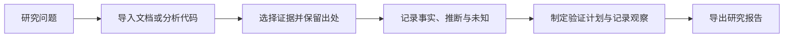

# FeatureLens Research · 知微

[](https://github.com/forest-USTC/featurelens-research/actions/workflows/ci.yml)
[](https://github.com/forest-USTC/featurelens-research/releases)
[](LICENSE)

**面向产品经理的功能研究工具：把文档和代码线索，整理成带出处、分清事实与推断的研究报告。**

例如，研究“知识库没有匹配资料时，产品会怎样响应”：导入产品说明，找到相关规则，引用原文记录判断，再把尚未实测的行为列成验证计划。每条结论都能回到材料，每个未确认的问题都能继续跟进。

提供 **Python CLI 和 25 个 MCP 工具**。可以在终端操作，也可以让支持 MCP 的 AI 客户端调用。

[快速开始](#快速开始) · [报告样例](examples/document-research.md) · [MCP 接入](docs/mcp.md) · [命令指南](docs/usage.md) · [常见问题](docs/troubleshooting.md)

## 能做什么

| 任务 | 输入 | 得到什么 |
| --- | --- | --- |
| 研究产品规则 | TXT、Markdown、DOCX、文字型 PDF | 带行号、段落号或页码的材料片段 |
| 查找实现线索 | 已解包的标准 JavaScript 目录 | 函数、条件、调用等语法节点及对应源码 |
| 组织判断 | 选定证据与研究问题 | 材料事实、分析推断、待确认问题 |
| 跟踪验证 | 测试步骤、预期、观察与证据 | 保留每次尝试的验证记录 |
| 交付研究 | 当前研究记录 | Markdown 报告或完整 JSON |
| 管理资料 | 研究项目与原始材料 | 修改历史、归档、回收区、可迁移备份 |



适合功能规则梳理、产品方案核查、代码线索研究，以及在交付分析结论前整理证据。工具检查引用与文件完整性，业务判断仍需研究者负责。

## 快速开始

需要 **Python 3.11+**；推荐 3.12。先[安装 uv](https://docs.astral.sh/uv/getting-started/installation/)。当前自动测试覆盖 macOS 本地环境与 Ubuntu CI，未验证 Windows。

```bash
git clone https://github.com/forest-USTC/featurelens-research.git
cd featurelens-research
uv sync --locked
uv run featurelens demo-document --json
```

这条命令会自动完成：创建研究 → 导入内置文档 → 引用片段 → 记录三类判断 → 创建待执行验证 → 导出报告。**无需 Node、模型密钥或手动复制 ID。**

返回结果包含 `study_id`、`document_id` 和报告路径 `report`。报告默认保存在 `~/.featurelens/data/reports/`。每次运行创建独立的演示研究。

示例报告中的内容：

> **材料事实**：示例文档要求，没有资料达到阈值时提示参考资料不足，并引导用户补充问题或资料。
>
> **待确认**：实际问答是否会在无匹配资料时仍生成未经引用支持的答案？
>
> **验证状态**：待执行。

[查看完整报告样例](examples/document-research.md)。示例材料是虚构的；它演示研究方法，不代表对真实产品的测试结果。

### 使用自己的材料

```bash
uv run featurelens create --title '功能规则研究' --question '资料不足时如何响应？' --json
```

记下返回的研究 ID，再导入文件：

```bash
uv run featurelens import-document --study-id r_实际ID --path '/绝对路径/产品说明.pdf' --json
```

后续搜索、引用、判断和验证操作见[命令指南](docs/usage.md)。喜欢自然语言交互，可以直接[接入 MCP 客户端](docs/mcp.md)。

### 从发布包安装

也可以在 [Releases](https://github.com/forest-USTC/featurelens-research/releases/latest) 下载 `.whl`，按照[安装指南](docs/installation.md)安装。项目尚未发布到 PyPI，请使用源码或 Release 安装包。

## 可选：JavaScript 静态分析

仅这个模块需要 **Node.js 22+ 和 npm**。在源码目录运行：

```bash
npm ci --prefix src/featurelens/js --ignore-scripts
uv run featurelens demo --json
```

扫描器读取 `.js`、`.mjs`、`.cjs`，提取语法线索，不执行目标应用。不直接支持 ASAR、`.app`、TypeScript、JSX 或原生二进制，也不解析跨文件调用链。[分析命令与支持范围](docs/usage.md#静态分析)

## 数据保管

默认数据目录是 `~/.featurelens/data`，可通过 `FEATURELENS_DATA_DIR` 或 `--data-dir` 指定。原始文件、提取片段和分析结果保留哈希；修改原件后需要重新导入或分析。

- **修改**：更新研究标题和问题，保留修订历史。
- **归档**：从默认列表隐藏，可取消归档。
- **删除**：移入回收区，可恢复，不永久清理原始证据。
- **备份与恢复**：打包研究记录及其引用的原始材料，校验后恢复到新目录。

详细操作见[研究管理与备份](docs/usage.md#研究管理与备份)。备份和报告包含材料原文及来源路径；请按研究资料保管。

## 当前范围

这是可用于本地研究的早期版本。文档提取不包含 OCR；PDF 多栏、表格和 DOCX 特殊对象需要核对。检索目前为字面匹配，尚未提供 RAG、向量检索、知识图谱或模型评测。

CLI 本身不调用模型。MCP 模式下，推理由所连接的客户端提供。该工具不是通用反编译器，也不自动证明业务结论正确。

详细格式限制与资源上限见[支持范围](docs/limits.md)。

## 开发与反馈

```bash
uv sync --locked
npm ci --prefix src/featurelens/js --ignore-scripts
uv run pytest -q
uv build
```

- [提交问题或功能建议](https://github.com/forest-USTC/featurelens-research/issues)
- [贡献指南](CONTRIBUTING.md)
- [版本记录](CHANGELOG.md)

使用 [MIT License](LICENSE)。第三方依赖遵循各自许可证。
